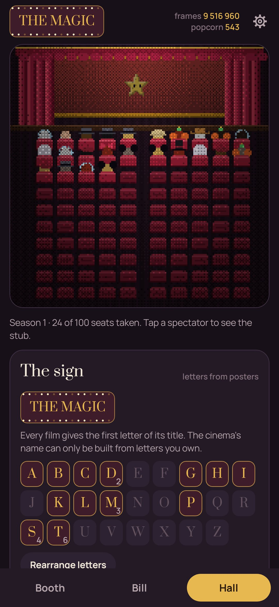

# Reelkin

**Films and series raise a small pet in a projectionist's booth.** · [Русская версия](README.ru.md)

Something sleeps in a film can. Log three films and the can opens: the genres decide who climbs
out (noir gives a cat, horror a bat, animation a fox…). Every minute you watch is 24 frames a second
of light for the pet, and every film is a ticket stub and a spectator in a hundred-seat hall.

- **The booth.** Put a film on the projector: the lights go down, the reels turn and the pet watches
  from the port, jumping at horror and laughing at comedy. When the credits roll you tear a stub:
  popcorn from one to five, three words, who you watched with, and whether there was a post-credits scene.
- **Traits.** The third film of a genre gives the pet something to keep: a fedora for noir, an antenna
  for sci-fi, a red nose for comedy, white gloves for animation, neck bolts for horror.
- **The hall.** A hundred velvet seats fill with spectators dressed by genre: detectives, cowboys,
  ghosts, astronauts. Tap one to see the stub.
- **The sign.** Each film gives the first letter of its title, and the cinema's name can only be built
  from the letters you own.
- **The time machine and the map.** Decades fill the booth with new gear; countries leave stamps.
- **Series** run on a season ticket: an episode tears a ticket, «cliffhanger!» marks the worst moment,
  a finale seats a spectator. A dropped series is simply taken off, no guilt.
- **What's on?** Say how much time you have and what you're in the mood for, and the pet picks from
  the bill what fits, favouring a decade or a country you don't have yet. There's a double bill too.
- **The year's awards** you hand out yourself; the statuettes stay on the shelf.
- **The buffet** sells string lights, a velvet armchair, a «HUSH» neon and a popcorn machine for popcorn.

Only the booth, the hall, the pet and the posters are pixel art; the rest of the app is soft and plain.
Everything stays on the phone. The internet is used only for the film search (Wikidata and Wikipedia posters).

| | | |
|---|---|---|
|  |  |  |
|  |  |  |

## Build

```
./gradlew assembleDebug                 # app.reelkin.dev
./gradlew assembleDebug -Pdemo          # app.reelkin.demo with a year of classics
./gradlew testDebugUnitTest -Prender --tests '*RenderScreens*' && python tools/shots.py
python tools/icon.py                    # launcher icon and docs/logo.png
```

Fonts: Prata, PT Sans Narrow, Manrope (SIL Open Font License). MIT licence.
