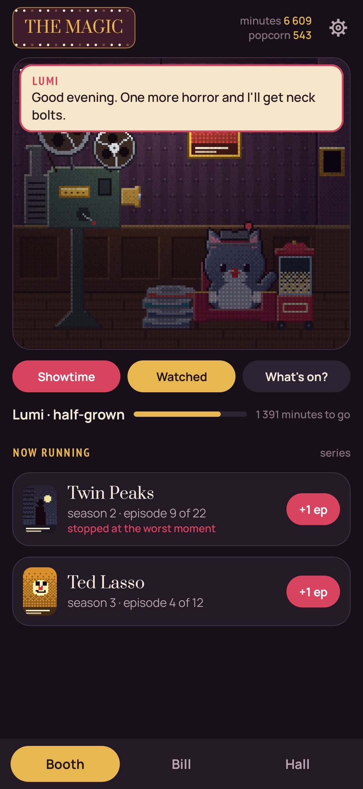
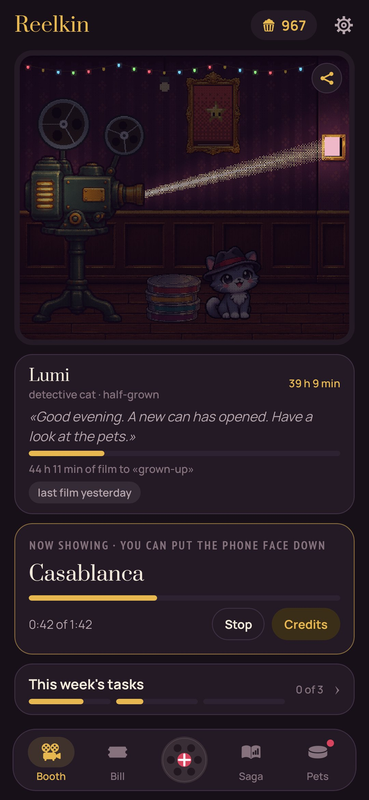
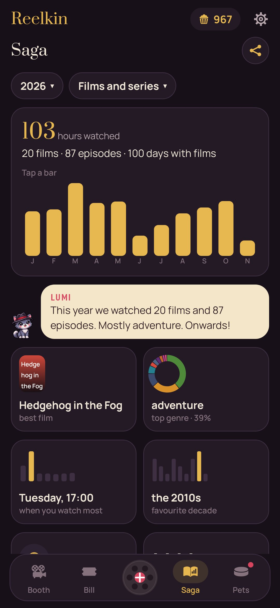
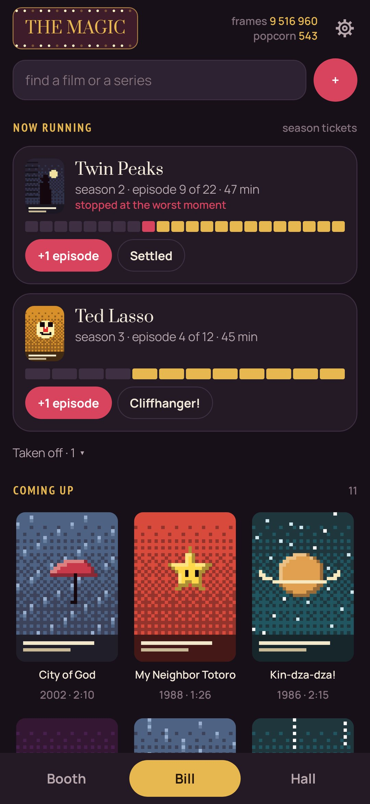
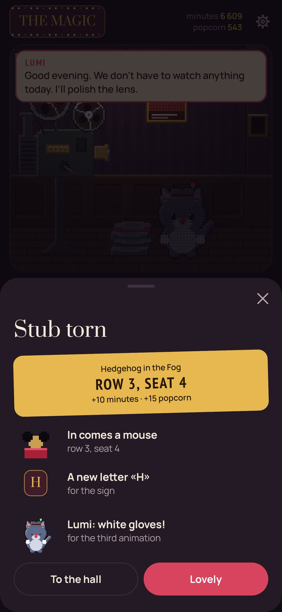
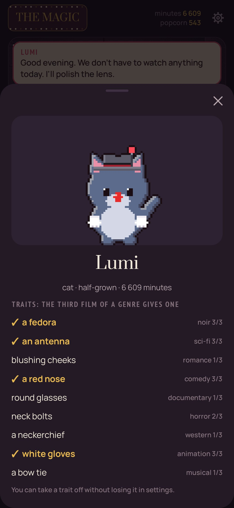

# Reelkin

**Films and series raise a small pet in a projectionist's booth.** · [Русская версия](README.ru.md)

Something sleeps in every film can. Three are open from the start (a detective cat, an animator fox, a critic owl); the other 46 open by the way you watch: horror, westerns, films after midnight, old films, rewatches, series binged. Not only animals: a little dragon, a unicorn, a phoenix, a kitsune, a back-row ghost, a golem of film cans, and a whole anime shelf: a tanuki, a kappa, a nekomata, a mecha, a lucky cat. Every minute you watch helps the pet grow,
and every film is a ticket stub and a spectator in a hundred-seat hall.

- **The booth.** Put a film on the projector: the lights go down, the reels turn and the pet watches
  from the port, jumping at horror and laughing at comedy. When the credits roll you tear a stub:
  popcorn from one to five, three words, who you watched with, and whether there was a post-credits scene.
- **Pets.** Each has favourite films that feed it one and a half times as much and pay popcorn, and a
  nature of its own (a greedy one grows faster, a curious one is paid for new countries); grown up, it
  takes a form for good from what it was fed. Only the one in the booth eats; call the others back any time.
- **The saga.** A week, a month, a year or all time: hours, days with films, best films and series,
  genres, countries, decades, hours and weekdays, records, a calendar of the year, and what the pet makes of it.
- **Goals, tasks and achievements.** Goals picked from a couple of dozen, weekly tasks and 88 achievements
  in steps, each step paying popcorn.
- **Postcards** for a feed or a story: a stub's review, an achievement, the booth, the pet, the numbers,
  genres, rhythm, the year in squares, the menagerie, with a QR code to Google Play if you like.
- **The hall.** A hundred velvet seats fill with spectators dressed by genre: detectives, cowboys,
  ghosts, astronauts. Tap one to see the stub.
- **The time machine and the map.** Decades fill the booth with new gear; countries leave stamps.
- **Series** run on a season ticket from any season: an episode tears a ticket, «cliffhanger!» marks the
  worst moment, a finale seats a spectator. A dropped series is simply taken off, no guilt.
  A series' card shows how many seasons are out and when the next one starts.
- **Your history comes along:** series from a public MyShows profile, ratings from Kinopoisk
  (Settings → Bring your history).
- **The bill** keeps what's waiting, what's running and a wall of stubs by month, with search and filters
  by genre, popcorn, year, company, directors and cast (fetched from Wikidata).
- **Tonight and What's on?** Pick a mood, and the pet picks from the bill what fits, favouring a decade
  or a country you don't have yet. There's a double bill too.
- **The year's awards** you hand out yourself; the statuettes stay on the shelf.
- **The buffet** sells wallpapers for the booth, string lights, a velvet armchair, a «HUSH» neon, a popcorn
  machine, a rug, a plant and a clock for popcorn, and lets you try each on first.

Only the booth, the hall and the pet are pixel art; the rest of the app is soft and plain, with a
dimmed photo behind it if you like.
Everything stays on the phone. The internet is used only for the film search (Wikidata and Wikipedia posters),
a series' seasons (MyShows, TVmaze) and bringing a history over, when you start it.

| | | |
|---|---|---|
|  |  |  |
|  |  |  |

## Build

```
./gradlew assembleDebug                 # app.reelkin.dev
./gradlew assembleDebug -Pdemo          # app.reelkin.demo with a year of classics
./gradlew testDebugUnitTest -Prender --tests '*RenderScreens*' && python tools/shots.py
python tools/icon.py                    # launcher icon and docs/logo.png
```

Fonts: Prata, PT Sans Narrow, Manrope (SIL Open Font License). MIT licence.
