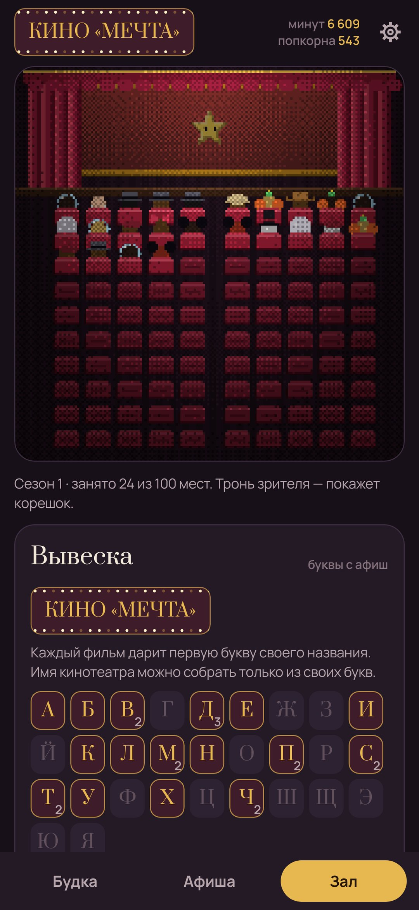

# Бобина

**Дневник фильмов и сериалов с питомцем, который живёт в будке киномеханика.** · [English](README.md)

В коробке с плёнкой кто-то спит. Отметь три фильма, и коробка откроется, а кто из неё вылезет, решат
жанры: нуар даст кота, хоррор нетопыря, мультфильмы лиса. Каждая просмотренная минута растит питомца,
каждый фильм — корешок билета и зритель в зале на сто мест.

- **Будка.** Ставь фильм на проектор: гаснет свет, крутятся бобины, а питомец смотрит из окошка,
  пугается хоррора и смеётся над комедиями. На титрах отрываешь корешок: попкорн от одного до пяти,
  три слова, с кем смотрел, была ли сцена после титров.
- **Черты.** Третий фильм жанра дарит питомцу примету: нуар — шляпу, фантастика — антенну,
  комедия — красный нос, мультфильмы — белые перчатки, хоррор — болты на шее.
- **Зал.** Сто бархатных кресел заполняются зрителями по жанрам: детективы, ковбои, призраки,
  космонавты. Тронь зрителя, и он покажет корешок.
- **Вывеска.** Каждый фильм дарит первую букву названия, и имя кинотеатра собирается только из своих букв.
- **Машина времени и кругосветка.** Десятилетия добавляют технику в будку, страны оставляют штампы.
- **Сериалы** идут по абонементу: серия отрывает билет, «оборвалось!» отмечает клифхэнгер, финал
  сезона сажает в зал зрителя. Брошенный сериал можно просто снять с проката, без угрызений.
- **«Что ставим?»** Скажи, сколько есть времени и какое настроение, и питомец выберет из афиши то,
  что влезает, а заодно даст новое десятилетие или страну. Есть и двойной сеанс.
- **Премию года** вручаешь сам, статуэтки остаются на полке.
- **Буфет** продаёт за попкорн гирлянду, бархатное кресло, неон «ТИШЕ» и попкорн-машину.

Пиксельные здесь только будка, зал, питомец и афиши, остальное приложение — мягкое и спокойное.
Всё хранится на телефоне. В интернет — только поиск фильмов (Wikidata и афиши из Википедии).

| | | |
|---|---|---|
|  |  |  |
|  |  |  |
