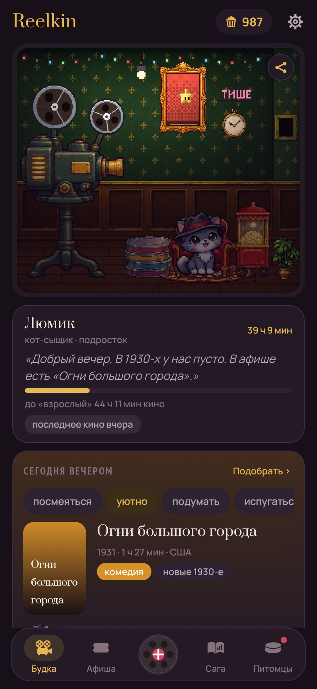
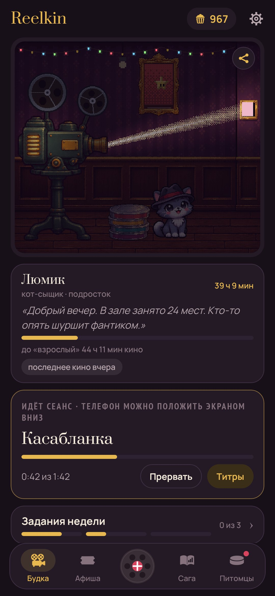
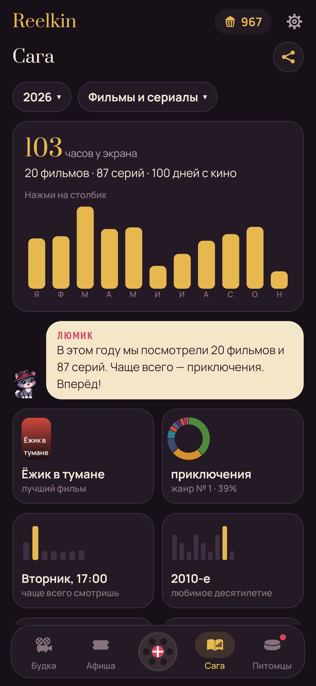
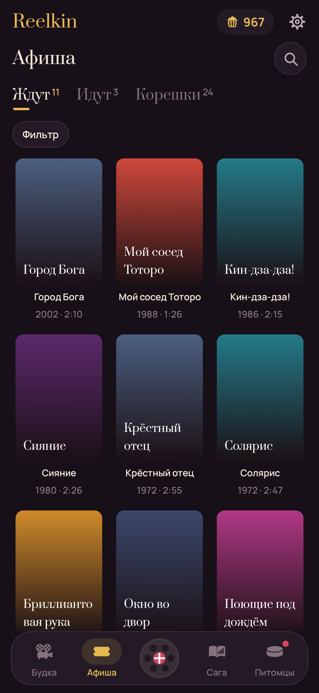
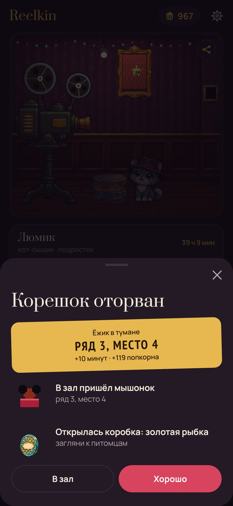
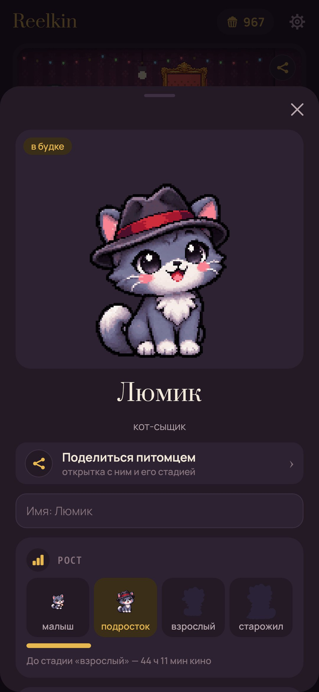

# Reelkin

**Дневник фильмов и сериалов с питомцем, который живёт в будке киномеханика.** · [English](README.md)

В коробках с плёнкой кто-то спит. Три коробки открыты сразу — кот-сыщик, лис-аниматор и сова-критик, —
остальные 46 открываются тем, как ты смотришь: хорроры, вестерны, кино после полуночи, старые фильмы,
пересмотры, сериалы запоем. Среди них не только звери: дракончик, единорог, феникс, кицунэ, призрак
последнего ряда, голем из коробок с плёнкой, а на аниме-полке тануки, каппа, нэкомата, меха-робот и манэки-нэко. Каждая минута в будке растит питомца: из коробки — малыш,
подросток, взрослый, старожил; каждый фильм — корешок билета и зритель в зале на сто мест.

- **Будка.** Ставь фильм на проектор: гаснет свет, крутятся бобины, а питомец смотрит из окошка,
  пугается хоррора и смеётся над комедиями. На титрах отрываешь корешок: попкорн от одного до пяти,
  три слова, с кем смотрел, была ли сцена после титров.
- **Питомцы.** У каждого свои любимые фильмы: они кормят в полтора раза сытнее и приносят попкорн.
  У каждого характер (обжора растёт быстрее, любопытный получает попкорн за новые страны), а взрослый
  навсегда принимает форму по тому, чем его кормили. Ест только тот, кто сейчас в будке; остальных
  можно позвать обратно когда угодно.
- **Сага.** Неделя, месяц, год или всё время: часы, дни с кино, лучшие фильмы и сериалы, жанры,
  страны, десятилетия, часы и дни недели, рекорды, календарь года — и что обо всём этом думает питомец.
- **Цели, задания и достижения.** Цели на выбор из двух десятков, задания недели и 88 достижений
  со ступенями: за каждую ступень — попкорн.
- **Открытки** для соцсетей, постом или сторис: отзыв с корешка, достижение, будка, питомец, итоги,
  жанры, ритм, год квадратиками, зверинец. На открытке можно оставить QR-код на Google Play.
- **Зал.** Сто бархатных кресел заполняются зрителями по жанрам: детективы, ковбои, призраки,
  космонавты. Тронь зрителя, и он покажет корешок.
- **Машина времени и кругосветка.** Десятилетия добавляют технику в будку, страны оставляют штампы.
- **Сериалы** идут по абонементу с любого сезона: серия отрывает билет, «на самом интересном!» отмечает клифхэнгер, финал
  сезона сажает в зал зрителя. Брошенный сериал можно просто снять с проката, без угрызений.
  Сколько сезонов вышло и когда выйдет следующий, видно в карточке сериала.
- **История переезжает с тобой:** сериалы из открытого профиля MyShows, оценки с Кинопоиска
  (Настройки → Перенести историю).
- **Афиша** хранит то, что ждёт, что идёт, и стену корешков по месяцам, с поиском и фильтрами по жанру,
  попкорну, году, компании, режиссёрам и актёрам (их подтягивает Wikidata).
- **«Сегодня вечером» и «Что ставим?»** Выбери настроение, и питомец предложит из афиши то, что влезает,
  а заодно даст новое десятилетие или страну. Есть и двойной сеанс.
- **Премию года** вручаешь сам, статуэтки остаются на полке.
- **Буфет** продаёт за попкорн обои для будки, гирлянду, бархатное кресло, неон «ТИШЕ», попкорн-машину,
  ковёр, цветок и часы — всё можно сначала примерить.

Пиксельные здесь только будка, зал и питомец, остальное приложение — мягкое и спокойное, при желании
с приглушённым фото на фоне.
Всё хранится на телефоне. В интернет — только поиск фильмов (Wikidata и афиши из Википедии), сезоны
сериалов (MyShows, TVmaze) и перенос истории, когда ты сам его запускаешь.

| | | |
|---|---|---|
|  |  |  |
|  |  |  |
